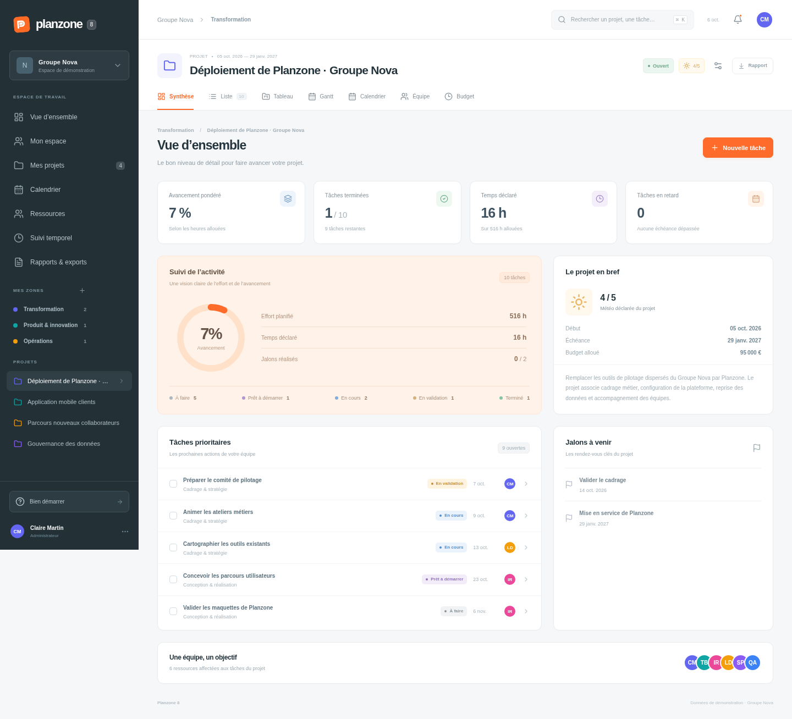

# Planzone 8

Première application fonctionnelle issue du cadrage et des références Planzone 7 fournis. Interface française, adaptée à l’ordinateur et au mobile, avec une API et des données persistantes : SQLite en local, Cloudflare D1 sur le web.

**Tester l’application en ligne : [Planzone 8](https://planzone8-demo.aldeguer-remi.workers.dev).** Une connexion est requise ; chaque membre retrouve les projets et les actions autorisés par ses rôles.



## Lancer l’application

Prérequis : **Node.js 24 ou supérieur** et npm. Aucun service de base de données externe n’est nécessaire.

```bash
npm ci
npm run build
npm start
```

Sur la machine où ces commandes tournent, ouvrir `http://127.0.0.1:3001`. Au premier lancement, l’application crée `data/planzone.sqlite` avec quatre projets et des ressources fictives. Un compte local est créé avec un mot de passe aléatoire conservé dans le fichier privé ignoré `data/admin-credentials.json`. Les modifications et le compte sont conservés après un rechargement ou un redémarrage. `PLANZONE_ADMIN_USERNAME` et `PLANZONE_ADMIN_PASSWORD` permettent de définir le premier compte local ; ils ne remplacent pas le mot de passe d’un compte existant.

Pour développer avec rechargement automatique :

```bash
npm run dev
```

Ouvrir alors `http://localhost:5173` sur cette machine. Vite relaie les requêtes `/api` vers le serveur local sur le port 3001. Éviter de lancer `npm start` et `npm run dev` simultanément sur les mêmes ports.

Dans l’environnement cloud, `bash scripts/cloud-setup.sh` installe les dépendances, compile et exécute les tests métier et API avec un cache npm accessible en écriture. Les adresses locales ci-dessus ne sont accessibles que depuis la machine exécutant l’application.

## Publier sur Cloudflare

Le [guide Cloudflare](docs/cloudflare-deployment.md) décrit la connexion du compte et la publication sur `workers.dev`. Configurer `CLOUDFLARE_ACCOUNT_ID` et le secret `CLOUDFLARE_API_TOKEN`, puis exécuter :

```bash
npm run deploy:cloudflare
```

Le script prépare la base D1, publie l’interface et l’API, puis affiche l’adresse publique après vérification. Aucune adresse publique n’est générée sans accès au compte Cloudflare.

Pour tester cette version sur sa propre machine : `npm run dev:cloudflare`. Le serveur Workers local utilise le port 8787 et une base D1 locale indépendante de SQLite. Dans l’environnement géré, définir `XDG_CONFIG_HOME=/tmp/planzone8-wrangler-config`, `WRANGLER_LOG_PATH=/tmp/planzone8-wrangler-logs` et `WRANGLER_SEND_METRICS=false` pour les commandes Wrangler.

Le premier déploiement crée le compte `admin` avec un mot de passe aléatoire conservé dans le fichier privé ignoré `.cloudflare/admin-credentials.json`. Les publications suivantes conservent son mot de passe, y compris après un changement depuis l’application. Le compte retrouve le même espace dans les différents navigateurs. Lors de sa première connexion depuis le navigateur utilisé pour l’ancienne démonstration, ses données peuvent être reprises si l’espace du compte n’a pas encore été modifié ; les lignes D1 existantes sont conservées.

La connexion utilise une session serveur expirant après sept jours, transmise exclusivement par cookie `HttpOnly`, `Secure` en HTTPS et `SameSite=Lax`. Les mots de passe sont hachés avec un sel aléatoire ; les tentatives répétées sont limitées. Le menu du compte permet de changer le mot de passe et de se déconnecter. Un changement de mot de passe invalide les autres sessions ouvertes. Un administrateur peut créer une connexion pour une ressource humaine active depuis sa fiche. Le rôle global de cette ressource et ses rôles projet s’appliquent à chaque requête ; changer un rôle prend effet immédiatement. Le compte administrateur principal conserve son autorité et ses identifiants existants.

## Parcours disponibles

- Comptes membres, quatre rôles globaux et trois rôles projet, autorisations appliquées dans les vues et l’API, déconnexion et changement de mot de passe.
- Création de projet en deux étapes, depuis zéro ou depuis un modèle : zone, statut, dates, description mise en forme, tags, portefeuilles nommés, champs personnalisés et activation des vues ; modification persistante de ces paramètres.
- Classement par zones, recherche globale et espace personnel avec listes de tâches à gauche et calendrier hebdomadaire à droite.
- Sidebar proche de PZ7 : projets récents, menus de gestion, zones avec projets imbriqués, compteurs réels, repli sur ordinateur et menu mobile ; Mon espace réunit Ma synthèse, Mes discussions et Suivi temporel dans des onglets communs.
- Vues de zone en tableau : synthèses repliables, dates, tags des tâches, équipe affectée, météo, travail et Budget (alloué, planifié, réel, marges, acquis selon l’avancement des allocations) ; recherche, tri, filtre de statut et statut du projet modifiable dans la ligne.
- Tâches, jalons, phases, tags éditables par puces, affectation, dates facultatives, avancement et dépendance à un prédécesseur ; coche cliquable pour terminer ou remettre une tâche à faire.
- Liste : listes et sous-listes repliables contenant des tâches, jalons et autres listes ; glisser-déposer avant, dans ou après une liste, ordre partagé persistant, création contextuelle, totaux récursifs et colonnes configurables.
- Synthèse, liste filtrable, tableau avec glisser-déposer et sélecteur de statut, Gantt, calendriers du projet et global, équipe, budget et suivi temporel du projet.
- Calendrier : bouton Ajouter pour tâche, jalon, événement ou indisponibilité ; événements avec participants, journées entières et plages horaires, modification et suppression, capacité recalculée.
- Documents du projet : dossiers et sous-dossiers, classement et déplacement des fichiers/liens, recherche, aperçu, téléchargement et gestion persistante.
- Discussions du projet et des tâches avec mentions, modification et suppression ; Mes discussions rassemble les fils où l’utilisateur est mentionné ou a participé.
- Annuaire : ajout direct d’un membre, création d’une ressource virtuelle ou matérielle ; équipe projet enrichie depuis les ressources déjà présentes dans la Planzone ou par création d’une ressource associée. Désactivation avec conservation des références ; profils de coûts séparés des droits d’accès.
- Fiche ressource complète : identité, e-mail, fonction, rôle, description, tags, profil de coût, champs personnalisés et projets associés.
- Gestion : tableaux Capacité, Charge prévisionnelle et Taux d’occupation par ressource, sur douze mois ou par semaine, calculés depuis les capacités des sept jours, les jours fériés et les indisponibilités ; affichage en heures ou jours et détail par projet.
- Délégations de validation des temps appliquées dans le suivi temporel et son API.
- Suivi temporel hebdomadaire Personnel/Équipe, lignes dépliables par ressource, projet, phase et tâche, sept jours et totaux historiques ; saisie, correction et validation des temps avec conservation du tarif associé.
- Budget projet : budget alloué modifiable depuis sa carte ou le bouton Modifier le budget ; dépenses prévues/réglées et recettes prévues/encaissées, avec création, modification, suppression et conservation après rechargement ; résultats prévisionnel et réel.
- Répartitions des coûts planifiés ou réels par catégorie de dépenses et type de ressources, synthèse ressources/dépenses, valeur acquise des allocations et budget disponible.
- Personnalisation : modèles de projet, champs personnalisés partagés, modèles de compte rendu, statuts de projet et axes stratégiques, accessibles directement dans la sidebar.
- Champs personnalisés : texte simple sur une ligne, texte riche, listes à choix multiples ou simple, formule, image, lien web ; les types Nombre et Date sont conservés. La catégorie Saisies de temps ajoute ces champs aux formulaires de création, correction et consultation des temps.
- Synthèse projet : compte rendu persistant depuis le bouton bleu, derniers comptes rendus avec auteur, date et indicateurs ; rapport flash depuis le bouton jaune orangé, imprimable ou enregistrable en PDF.
- Exports CSV des tâches, ressources et temps ; rédaction, consultation, modification, suppression et impression des comptes rendus du projet.

L’[état de couverture et les règles métier](docs/implementation.md) décrivent précisément la portée de cette première version.

### Rôles globaux et rôles projet

**Gestion → Ressources** permet d’attribuer Administrateur, Créateur de projet, Usager ou Visiteur à chaque membre humain. Dans **Projet → Équipe**, choisir Chef(fe) de projet, Collaborateur ou Observateur indépendamment pour chaque projet. Un visiteur reste observateur. Les membres voient leurs projets associés ; un créateur peut créer dans ses zones accessibles et devient chef du nouveau projet. L’administrateur accède à tous les projets.

Le chef de projet gère ses paramètres, son équipe, son budget, ses rapports et l’intégration de ses temps. Le collaborateur peut réaliser ses tâches, ajuster sa propre allocation et gérer les documents. L’observateur consulte le planning et les documents et peut participer aux discussions. **Gestion → Droits et rôles** permet à l’administrateur d’activer les actions de planning conditionnelles des collaborateurs, la lecture de l’annuaire, la gestion de la personnalisation et les règles des temps personnels. Les budgets et tarifs non autorisés sont retirés des réponses serveur.

Pour permettre à un membre de se connecter, ouvrir sa fiche enregistrée puis **Créer l’accès de connexion**, saisir un identifiant et un mot de passe initial. Cette action crée un compte dans le même espace ; aucune invitation par e-mail n’est envoyée. Le membre peut ensuite changer son mot de passe. La [matrice fournie](docs/role-permissions-matrix.json) sert de référence pour les fonctions existantes ; les domaines encore absents de l’application ne sont pas déclarés implémentés.

### Dossiers, saisies de temps et tableaux de ressources

Dans **Documents** du projet, **Nouveau dossier** crée un dossier à la racine ou dans le dossier ouvert. Le fil de navigation et l’arbre donnent accès aux sous-dossiers ; le formulaire d’un document permet de choisir sa destination. Les dossiers peuvent être renommés ou déplacés dans le même projet. Seuls les dossiers vides peuvent être supprimés. Les documents existants restent à la racine jusqu’à leur classement.

L’onglet **Documents** de la sidebar ouvre le catalogue global des fichiers et liens de tous les projets. La recherche couvre aussi les projets et chemins de dossiers ; les filtres portent sur le projet et le type. Chaque document indique son emplacement et permet d’ouvrir directement son dossier dans le projet, de consulter son aperçu ou de le télécharger. L’ajout demande de choisir un projet modifiable, puis son dossier. Les documents des projets clos ou interrompus restent consultables en lecture seule.

Chaque zone propose les onglets **Projets**, **Liste** et **Gantt**. Liste réunit les projets, leurs listes et sous-listes, tâches et jalons dans un tableau repliable. Gantt reprend cette hiérarchie sur un planning commun, avec une vue de l’ensemble de la zone et des échelles mois/trimestre/année. Les filtres portent sur le projet, le statut des tâches, la ressource, le type et le texte recherché. Les tâches s’ouvrent dans leur véritable projet ; leurs coches respectent les projets clos ou interrompus. L’option Toutes les zones conserve la vue choisie.
La **synthèse projet** reprend une disposition compacte : barre stratégique, météo et statut, actions bleue de compte rendu et orange de rapport flash, comptes rendus/description, jalons/activité et tâches à venir/en retard. Les deux listes de tâches proposent des filtres personnels indépendants. L’activité porte toujours sur le projet entier et présente les heures, les compteurs et une frise de jalons. Les accès Équipe, Discussions, Documents, Budget et Rapports restent associés au projet affiché. Les crayons ouvrent ses paramètres pour modifier description, stratégie, météo ou statut.


Dans **Personnalisation → Champs personnalisés**, choisir **Saisies de temps** pour définir les champs de la modale. Les neuf types disponibles sont utilisables ; une formule peut notamment référencer `{hours}`. Les valeurs sont sauvegardées avec le temps et restent consultables après validation. Corriger une saisie validée exige d’abord de retirer sa validation.

**Mon espace** propose les onglets **Ma synthèse**, **Suivi temporel** et **Mes discussions**, sans occuper trois lignes dans la sidebar. **Gestion** propose les routes `#resources/capacity`, `#resources/load` et `#resources/occupancy`. La capacité est la somme des capacités quotidiennes configurées, après déduction des jours fériés et absences. La charge vient des allocations datées ; le taux est charge/capacité. Une capacité nulle affiche un tiret, tout en conservant la charge visible. Le calendrier courant est utilisé pour toutes les périodes, sans historique de capacités.

Dépôt source : [RemiAldeguer/Planzone8](https://github.com/RemiAldeguer/Planzone8). Les reçus de déploiement, identifiants et bases locales sont exclus de Git.

### Organigramme

**Gestion → Organigramme** affiche les unités organisationnelles, leurs sous-unités et les ressources rattachées. Le bouton orange **Unité organisationnelle** ouvre le formulaire Nom / Unité parente / Ressources. Les unités existantes se renomment et se déplacent depuis le crayon ; le **+** crée une sous-unité. Les boutons bleus replient la hiérarchie. Une ressource peut être rattachée à plusieurs unités ; les ressources sans rattachement restent visibles dans leur propre groupe, et les inactives restent barrées.

Les lignes proposent le rôle global, le responsable organisationnel, la classification interne/externe et les champs personnalisés des ressources. Le responsable se retrouve dans la fiche ressource et n’accorde aucun droit de projet ou de validation. Les filtres portent sur la nature/activité et la recherche conserve les parents des résultats. Le bouton de colonnes choisit les champs affichés dans ce navigateur. Seul l’administrateur modifie l’organisation ; les autres rôles y accèdent en lecture selon le droit de consultation des ressources. Les cycles sont refusés et seules les unités vides peuvent être supprimées.

### Gantt et navigation du projet

Le **Gantt** reprend le même ordre manuel que Liste : projet, listes et sous-listes, tâches et jalons, y compris les éléments sans date. Les listes portent les dates et les allocations de leurs descendants. Recherche, filtres, repli par niveau, zoom, échelles projet entier/mois/trimestre/année, charges et repère d’aujourd’hui permettent de parcourir les projets longs. **Créer** et les boutons **+** des listes réutilisent les formulaires de Liste.

Relier le point de fin d’une barre au début d’une autre crée une contrainte **fin → début**. Cliquer sur le point puis sur l’élément suivant fonctionne aussi au clavier et au tactile. **Créer une contrainte** permet de choisir les éléments sans date ; les badges ou les flèches ouvrent le lien pour le modifier ou le supprimer. Le prédécesseur doit être terminé pour démarrer le successeur. Les cycles sont refusés. Le modèle conserve un prédécesseur par élément : remplacer un lien ouvre un formulaire explicite. Les contraintes et les dates planifiées sont persistantes, et modifier un lien conserve les dates existantes.

Les poignées aux deux extrémités des barres modifient le début et la fin ; glisser la barre déplace son intervalle. Les jalons se déplacent par leur poignée. Les gestes fonctionnent à la souris et au tactile, avec aperçu des dates, annulation par Échap et durée minimale d’un jour. Au clavier, les flèches déplacent une borne d’un jour (Maj : sept jours) ; cliquer une poignée ouvre la saisie des dates. Les dates sont enregistrées dans les éléments existants et reprises dans Liste. Les barres de listes restent les agrégats de leurs descendants. Le mode **Relier les barres** accepte deux clics ou un glissement entre barres.

Dans **Détails**, l’icône de réglage permet de choisir et d’ordonner statut, début, fin, durée, alloué, passé, restant, avancement, tags, responsable et champs personnalisés de tâches/projet. Le nom reste visible pendant le défilement des colonnes ; les choix sont personnels à ce projet et conservés dans le navigateur. Le passé inclut tout l’historique du projet.

Le menu vertical **Équipe, Discussions, Documents, Budget, Rapports** est commun à toutes les vues du projet. La barre horizontale garde **Synthèse, Liste, Tableau, Gantt, Calendrier, Suivi temporel**. Les deux menus tiennent compte des vues activées et des rôles ; la page Rapports conserve ce même contexte projet. Sur mobile, le menu projet devient une rangée compacte.

### Listes imbriquées du projet

La vue **Liste** utilise un seul tableau compact, avec niveaux indentés, dates, statut, tags, responsable, heures allouées et commentaires. **Créer → Liste** ajoute une liste à la racine ; le bouton **+** d’une liste permet d’y créer une tâche, un jalon ou une sous-liste. Les flèches replient ou déplient un niveau ou toute l’arborescence. La fiche d’une tâche propose un sélecteur **Liste** pour la déplacer, et l’édition d’une liste permet de changer son nom ou son parent. Seules les listes vides peuvent être supprimées.

Glisser le **nom ou la poignée** d’une tâche, d’un jalon ou d’une liste permet de le placer **avant** une ligne, **dans** une liste ou **après** une ligne. Une ligne orange marque l’insertion ; le centre d’une liste s’éclaire pour indiquer un dépôt à l’intérieur. La zone en bas du tableau place l’élément à la fin du projet, hors des listes. Les gestes tactiles et le formulaire ouvert par clic ou au clavier sur la poignée utilisent le même déplacement. L’ordre est partagé entre tâches et listes et conservé après rechargement ; un déplacement revient automatiquement à Aucun tri si un tri était actif. Les gestes rapides, le tactile et la souris utilisent les mêmes événements de pointeur. Échap annule le geste ; un dépôt hors du tableau ne change rien. Les descendants suivent leur liste et les cycles sont refusés. Le bouton **Imbriquer**, à côté du nom de chaque liste, permet de choisir directement une autre liste ou sous-liste de destination. Il conserve toutes ses tâches et sous-listes, y compris lorsque la destination est une ancienne phase.

Les listes affichent le nombre d’éléments, les dates et les heures allouées de tous leurs descendants, sans double comptage. Les filtres conservent les listes parentes des résultats ; les totaux restent ceux de la liste complète. La configuration des colonnes existante est conservée. Les anciennes phases restent visibles sans conversion automatique à la lecture ; les organiser en sous-listes ou les renommer crée leur liste persistante et conserve leurs tâches. L’import d’un projet dans un modèle et le clonage d’un modèle conservent les listes imbriquées et vides, avec de nouveaux identifiants.

La sidebar ne contient plus l’entrée Projets entre Personnalisation et Calendrier. **Tout**, les zones et les projets récents permettent d’accéder aux projets.

La **date d’intégration projet** du suivi du projet valide toutes les journées jusqu’à la date incluse, pour toutes ses ressources. La **date d’intégration ressource** de la feuille personnelle, ou de chaque ligne de la feuille Équipe, concerne uniquement cette ressource sur tous ses projets. Les dates s’appliquent à l’historique complet, indépendamment des filtres et de la semaine affichée. Les journées intégrées portent une coche ; leurs temps sont consultables et verrouillés. Ajuster ou retirer une date rouvre uniquement les périodes qui ne restent pas couvertes par une autre date ou une validation individuelle.

Les totaux journaliers des lignes de ressource et de projet, ainsi que la ligne **Total**, proposent aussi une icône calendrier avec coche. Elle ouvre la date d’intégration préremplie avec le jour choisi. Dans le suivi projet, elle cible le projet entier ; dans les feuilles personnelle et Équipe, elle cible une seule ressource. Le total général de la feuille Équipe demande de choisir la ressource à intégrer avant de valider.

### Suivi temporel et rapports du projet

L’onglet **Suivi temporel** du projet, sous `#project/<identifiant>/time`, ouvre sa grille hebdomadaire avec les ressources associées explicitement, affectées aux tâches ou jalons, ou ayant saisi du temps sur le projet. Les ressources inactives sont incluses par défaut pour conserver leur historique. Le filtre de personne et les nouvelles saisies restent limités aux membres du projet ; une nouvelle saisie exige une ressource active et une tâche disponible du projet. Les heures allouées suivent l’affectation actuelle et le passé reste attribué à son auteur. Le suivi global Personnel/Équipe reste accessible dans les onglets de Mon espace.

Dans **Synthèse**, **Créer un compte rendu** ouvre un formulaire bleu fondé sur les modèles de Personnalisation, ou sur un modèle simple si le catalogue est vide. Le titre, la date, les indicateurs et les champs sont enregistrés dans le projet avec l’auteur et les dates techniques fournis par le serveur. Chaque compte rendu conserve sa propre structure : modifier ou supprimer le modèle ne réécrit pas les comptes rendus existants. Les comptes rendus d’un projet clos ou interrompu restent consultables et imprimables ; leurs écritures sont verrouillées.

**Rapport flash** reprend la présentation du PDF de référence : couverture avec projet, zone, objet, météo, statut, dates, score stratégique, portefeuilles et description ; champs personnalisés, activité, travail, jalons, budget et tâches ouvertes. Un sélecteur permet de joindre un compte rendu enregistré du même projet ; l’objet et le compte rendu choisis se retrouvent dans l’export. Il s’imprime ou s’enregistre en PDF via le navigateur. Les comptes rendus enregistrés se rouvrent depuis la Synthèse ou Rapports ; leur impression utilise la version enregistrée. Le brouillon de rédaction dans Rapports peut également être imprimé ou envoyé au formulaire d’enregistrement.

### Recettes et répartitions du budget projet

Dans Budget, la carte **Budget alloué** et **Modifier le budget** ouvrent un montant modifiable au centime. L’enregistrement met à jour uniquement l’enveloppe du projet et recalcule les marges et la consommation, sans changer les coûts ni les recettes. Les paramètres de budget restent accessibles pour un projet clos ou interrompu, comme les autres paramètres du projet.

**Nouvelle recette** enregistre un libellé, une catégorie, un montant saisi au centime, une date prévue et une date d’encaissement facultative. Une recette peut être encaissée avant sa date prévue ; renseigner cette date la classe comme encaissée, et la vider la remet à encaisser. Les recettes restent séparées de l’enveloppe allouée au projet. Le résultat prévisionnel correspond aux recettes prévues moins les coûts planifiés ; le résultat réel aux recettes encaissées moins les coûts réels. Les dépenses et recettes restent consultables dans un projet clos ou interrompu, mais leurs mutations sont bloquées dans l’interface et l’API.

Le sélecteur Planifié/Réel commande les répartitions : Achat logiciel, Formation, Matériels, Fournitures, Frais juridiques et Autres pour les dépenses ; Externes, Internes, Matérielles, Virtuelles et Non classées pour les ressources. Le planifié utilise les allocations et les tarifs actuels. Le réel conserve le tarif de chaque saisie et la ressource ayant déclaré le temps, même après une réaffectation. Une date de règlement classe une dépense dans le réel. Les dépenses ne contribuent pas à la valeur acquise, calculée sur l’avancement des allocations. Sans tarif, les coûts affichés sont des minimums connus et les résultats des maximums ; les proportions portent uniquement sur les coûts connus.

### Personnalisation

Le menu Personnalisation propose cinq vues proches des références PZ7. Leurs catalogues sont persistants et initialement vides : les exemples et les noms présents sur les captures ne sont pas importés dans l’espace.

Les **modèles de projet** se préparent depuis une structure vide ou un projet existant. Ils conservent description, budget, couleur, phases, listes imbriquées, tâches, jalons, allocations, tags et dépendances internes. Créer un projet à partir d’un modèle recrée tous les identifiants et décale les dates en jours calendaires depuis son début, dans une transaction unique. Les affectations, avancements, temps, dépenses, recettes et commentaires historiques ne sont pas copiés.

Les **champs personnalisés** définissent un nom, des libellés français et anglais et l’un des neuf types disponibles. Ils apparaissent selon leur périmètre dans les fiches projet, tâche/jalon et ressource, ou dans la saisie des temps. Les champs de compte rendu compatibles peuvent être copiés dans un modèle. La gestion des définitions dépend des droits de personnalisation ; les valeurs respectent le rôle dans leur périmètre. Les anciens champs propres à chaque ressource restent conservés.

Les **modèles de compte rendu** enregistrent le titre, jusqu’à cinq indicateurs et l’ordre des champs. La rédaction depuis Rapports utilise ce modèle dans un brouillon local, imprimable ou enregistrable dans le projet ; le bouton de la Synthèse ouvre directement le formulaire persistant. Les comptes rendus enregistrés conservent une copie des libellés, types, indicateurs et valeurs indépendamment des évolutions du modèle.

Les **statuts de projet** personnalisés portent un libellé, une description, une couleur et un comportement Demandé, Ouvert, Interrompu ou Clos. Les quatre statuts natifs sont conservés en lecture seule. Un comportement Interrompu ou Clos applique les verrous existants. Les **axes stratégiques** définissent un code, une couleur, cinq libellés d’évaluation de −2 à 2 et un poids entier de 0 à 1000. Les paramètres du projet permettent son évaluation ; le score additionne les évaluations multipliées par leurs poids, avec zéro pour les axes non évalués.

Un statut utilisé, un axe évalué ou un champ portant encore des valeurs ne peut pas être supprimé : l’API refuse l’opération avec une erreur explicite, sans supprimer les données référencées.

## Vérifier

```bash
npm test
npm run build
npm run test:e2e
npm run test:e2e:cloudflare
```

Les tests API et navigateur utilisent des bases temporaires indépendantes des données de démonstration. Les tests navigateur nécessitent Chromium ; sous Linux ils utilisent `/usr/bin/chromium`. Sur une autre machine, définir `CHROMIUM_PATH` avec le chemin du navigateur Chromium/Chrome installé, par exemple :

```bash
CHROMIUM_PATH=/chemin/vers/chromium npm run test:e2e
```

## Organisation du code

| Dossier | Rôle |
|---|---|
| `src/` | Interface React et styles |
| `shared/` | Contrats TypeScript et calculs métier communs |
| `server/` | API Express, validation des mutations et SQLite |
| `cloudflare/` | Worker HTTP, persistance D1 et migration SQL |
| `tests/` | Tests métier, API et parcours Playwright |
| `scripts/` | Installation cloud et serveur de tests isolé |
| `data/` | Données locales générées, exclues de Git et de l’archive de code |

Variables facultatives : `PORT` (3001 par défaut), `HOST` (`127.0.0.1`), `DB_PATH` (chemin de la base), `APP_ORIGIN` (origine autorisée supplémentaire), `DEMO_TODAY` (date ISO pour une démonstration reproductible), `PLANZONE_ADMIN_USERNAME` et `PLANZONE_ADMIN_PASSWORD` (premier compte SQLite uniquement). Pour `npm run dev`, conserver l’API sur le port 3001 utilisé par le proxy Vite.

Pour sauvegarder les données, arrêter le serveur puis copier le dossier `data/` complet. Pour restaurer, remettre ce dossier au même emplacement avant de redémarrer. Ne pas supprimer la base pour résoudre un problème d’installation.

## Portée

Cette version fournit une **connexion avec un compte administrateur** et un espace partagé entre les sessions de ce compte. La création de comptes supplémentaires, les droits par zone/projet et la matrice complète des permissions restent à développer. Les rôles des fiches ressources sont des paramètres métier distincts du compte de connexion ; le compte administrateur conserve son autorité de validation des temps et de gestion des discussions et documents. Les fichiers du projet sont limités à 512 Ko chacun ; les images des champs à 64 Ko. Les pièces jointes spécifiques aux dépenses et comptes rendus, les circuits de validation des comptes rendus, les portefeuilles et les intégrations restent à développer. Les règles métier sont communes aux versions Express/SQLite et Workers/D1 ; une architecture Spring Boot/MySQL évoquée dans le contexte reste une évolution à décider.

Le [guide de stockage et d’accès](docs/backend-storage.md) décrit le chiffrement des snapshots D1, la migration sans réinitialisation et les copies privées de clés. Les fichiers des projets sont chargés à la demande après contrôle de la session et du projet ; leur contenu n’est plus inclus dans l’état global du navigateur. Le Gantt dispose de **Zoom arrière**, **Zoom avant** et d’un retour à **100 %**, de 25 à 400 %, en conservant le point central du planning.
