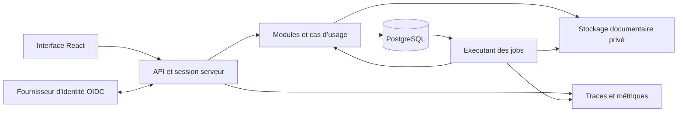

# Proposition initiale d’architecture de Planzone 8

Statut : remplacée le 13 octobre 2026 par la [spécification Java et Spring](../superpowers/specs/2026-10-13-planzone8-design.md), désormais document de référence pour la revue.

L’utilisateur a choisi de conserver Java pour l’équipe actuelle. La cible est Java 21 Temurin, Spring Boot, PostgreSQL et React/TypeScript, avec une Planzone par client, contenant ses zones et ses projets. Les détails, versions, invariants et critères de réception sont dans la spécification liée ci-dessus. Les nouveaux rôles de zone évoqués ci-dessous ne sont pas retenus dans le périmètre initial.

Le contenu suivant conserve la proposition antérieure pour tracer l’arbitrage. Sa recommandation NestJS et son hypothèse de compétences équivalentes sont caduques. Il ne doit pas servir de plan d’implémentation.

## Objectif et périmètre confirmé

Planzone 8 démarre comme un produit indépendant pour de nombreuses organisations clientes. Le socle doit permettre de modifier une fonction sans disperser ses règles, isoler les données des clientes et accompagner une augmentation mesurable des usages. L’architecture doit être portable ; le fournisseur d’hébergement sera choisi ensuite. Une migration de PZ7 sera étudiée plus tard.

Les fonctions présentes dans PZ8 constituent la référence de comportement : projets, équipes, listes et Gantt, ressources et capacité, calendrier, temps, budget, documents, discussions, rapports et personnalisation. Leurs implémentations et leurs écrans peuvent évoluer ; les historiques, calculs, autorisations et verrous doivent rester explicites.

Modèle métier confirmé par l’utilisateur : une cliente dispose d’une Planzone, qui contient plusieurs zones ; chaque zone contient des projets. La Planzone est le périmètre d’isolation de la cliente. Une zone est une subdivision métier de cette Planzone et peut porter des droits propres. Une organisation commerciale et sa Planzone restent deux concepts possibles, liés un à un dans le périmètre initial ; ils ne créent pas deux niveaux de tenancy indépendants.

La migration PZ7, la facturation commerciale, les applications natives, les droits arbitrairement personnalisables et les nouveaux circuits d’approbation ne sont pas déclarés dans cette première refonte. Leur ajout exigera un cadrage propre. Une extraction de service ne sera envisagée que pour un besoin d’exploitation ou de charge constaté.

## Evidence et limites

Le [registre de preuves PZ7](pz7-evidence.json) conserve projets, commits, chemins et lignes exacts. Les dépôts lus sont des versions de develop ; ils ne constituent pas une description certifiée de la production.

| Affirmation | Statut et source | Confiance et impact |
|---|---|---|
| PZ8 impose un stockage synchrone avec lectures globales | Verifie : server/contracts.ts lignes 20 à 25 ; server/store.ts lignes 97 à 98 | Contrats du code inspectes ; changer seulement le moteur ne suffit pas |
| Une mutation D1 réécrit tout le snapshot et utilise une révision | Verifie : cloudflare/worker.ts lignes 215 à 235 | Protection concurrente existante, avec travail et contention par espace |
| Mutation et actualisation sont liees dans l’interface | Verifie : src/App.tsx lignes 124 à 131 | Un succes d’ecriture peut être presente comme un échec de chargement |
| Sessions et droits serveur existent déjà | Verifie : server/auth.ts ; server/service.ts lignes 789 à 852 ; shared/permissions.ts | Acquis a conserver, sans conclure que le futur SaaS est sécurisé |
| Compte, organisation, Planzone et ressource sont distincts dans PZ7 | Verifie : registre PZ7, backend a8684583e9b47826bc3061d0e089a1eee706933e | Plusieurs modèles concordants ; cardinalites cibles à définir explicitement |
| PZ7 possede un backend relationnel et des traitements différés | Verifie : registre PZ7, dépendances et consommateurs du même commit | Reference de contraintes ; aucune obligation de conserver Java, MySQL ou RabbitMQ |
| Compilation, types et 355 tests PZ8 passent | Verifie localement avant ce cadrage | Baseline fonctionnelle ; aucune preuve de capacité, de RLS ou de restauration cible |

Les connaissances de l’équipe, les volumes, la concurrence, les exigences contractuelles et le budget d’exploitation ne sont pas établis. La recommandation suppose une équipe capable de maintenir TypeScript et PostgreSQL. La récupération des changements non commités du chat cloud reste distincte du cadrage : aucun de ses changements n’est considéré comme une référence acquise.

## Comparaison et direction recommandée

La sécurité est un critère eliminatoire : chaque option doit demontrer les mêmes invariants d’isolation, de transaction, de révocation et de récupération. Les notes suivantes sont des jugements d’ingenierie, pas des performances mesurees ni des coûts commerciaux.

Les pondérations refletent le besoin confirmé de structure, de données fiables et de portabilite : frontieres et maintenabilite 25 %, transactions et évolution 25 %, exploitation et récupération 15 %, continuité PZ8 15 %, portabilite 20 %. Notes de 1 à 5, à compétences équivalentes.

| Critere | A Node TypeScript et PostgreSQL | B Java Spring et PostgreSQL | C Worker et relationnel avec queues |
|---|---:|---:|---:|
| Frontieres et maintenabilite | 4 | 4 | 4 |
| Transactions et évolution | 4 | 4 | 3 |
| Exploitation et récupération | 3 | 3 | 3 |
| Continuite avec PZ8 | 4 | 3 | 4 |
| Portabilite | 4 | 4 | 2 |
| Total pondéré | 3,85 | 3,70 | 3,20 |

Direction proposée : A, un monolithe modulaire TypeScript avec PostgreSQL, distribue comme une API et un executant de jobs utilisant le même cœur métier. React et Vite sont conserves pour l’interface. Le gain de A est la réutilisation sélective du métier TypeScript et une chaine de développement commune, sans supériorité intrinsèque annoncée en sécurité ou en capacité.

NestJS avec son adaptateur Express est proposé pour l’assemblage HTTP et l’injection explicite des dépendances. Les objets et règles du domaine restent indépendants de Nest. Les modules Nest exposent leurs providers explicitement ; une vérification supplementaire des imports et des cycles restera obligatoire. [Modules NestJS](https://docs.nestjs.com/modules)

B reste une alternative crédible si les compétences et l’exploitation de l’équipe favorisent Java. C distingue runtime Worker et moteur de données : Worker avec PostgreSQL n’est pas équivalent a D1. Son orchestration de transactions et sa dependance aux services de plateforme doivent être démontrées avant adoption. Le snapshot D1 actuel n’est pas une variante acceptable de la cible.

L’écart A B est faible. Les analyses convergent sur les frontieres et les preuves, mais ne permettent pas de trancher les compétences de l’équipe. La lentille métier demande de contenir les nouveautes ; la lentille sécurité demande une couverture de toutes les voies d’acces ; la lentille exploitation demande de valider un parcours complet avant de généraliser les abstractions. La synthèse est une tranche representative, des roles initiaux limites et des interfaces publiques petites.

## Structure du code et dépendances

```text
apps/
  web/                       composition, routes et fonctions React
  api/                       entrée HTTP, configuration et assemblage
  jobs/                      executant des effets différés
packages/
  contracts/                 schemas de requêtes, réponses et événements
  domain/
    organizations/
    planzones/
    projects/
    planning/
    resources/
    time/
    budget/
    collaboration/
    customization/
  platform/                  PostgreSQL, identité, fichiers et instrumentation
  ui/                        composants accessibles et tokens visuels
migrations/
docs/
```

Chaque module métier comporte domain, application et ports, avec une entrée publique. Le domaine contient les invariants et les types ; application orchestre ses cas d’usage ; les ports concernent de vraies frontieres telles que stockage, identité, fichiers et effets externes. Une interface n’est pas ajoutee pour chaque classe.

Les entrées HTTP traduisent contrats et erreurs, puis invoquent un cas d’usage. Elles ne font pas de SQL et ne portent pas de règles métier. Le frontend utilise les contrats publics, jamais les repositories ou les entites persistantes. Les adaptateurs implementent les ports ; le domaine ne depend ni du framework HTTP ni du driver.

Les modules communiquent par leurs entrées publiques. Les lectures transversales de synthèse disposent d’un adaptateur de projection explicitement autorise ; aucune jointure libre entre tables d’autres modules n’est autorisee dans les controllers. Les dépendances permises sont declarees et vérifiées en CI. Les cycles et imports internes font echouer ce contrôle. Les repositories génériques all/get/put/remove et un dossier shared contenant tout le produit ne sont pas reconduits.

Une seule installation du dépôt, un lockfile et des workspaces npm sont proposés. Les versions de runtime supportées, images et dépendances seront verrouillees au premier increment et mises a jour par changements contrôles. La production utilisera une version Node LTS supportee. [Cycle de versions Node](https://nodejs.org/en/about/previous-releases)

## Composants et circulation des données



API et jobs peuvent être répliqués indépendamment avec le même modèle de droits. PostgreSQL est l’autorité des données métier. Les fichiers disposent d’un stockage privé expose par un adaptateur d’objets ; aucun chemin interne ne devient un lien public.

La proposition initiale utilise une outbox et une file durable dans PostgreSQL. Une queue externe ne sera introduite que si les mesures montrent un besoin et si sa semantique est équivalente. La recherche initiale passe par des requêtes et index PostgreSQL. Une couche de cache distribue ou un moteur de recherche distinct exigera une justification mesuree.

## Identite et autorisation

Une identité de connexion est globale, et peut posséder plusieurs adhésions actives. Elle est distincte d’une ressource de planning, qui peut exister sans compte. Les ressources virtuelles ou materielles n’obtiennent pas d’acces de connexion.

Un fournisseur OIDC est proposé derriere un port d’identité, afin de ne pas reconstruire les mecanismes de connexion et de récupération des mots de passe dans le métier PZ8. Le compte est lie au couple émetteur et sujet ; l’email n’est pas un identifiant stable ni une preuve automatique d’appartenance à une organisation. Le prestataire reste interchangeable. [Stabilite des identifiants OIDC](https://openid.net/specs/openid-connect-core-1_0.html#ClaimStability)

L’API realise le flux authorization code avec PKCE et protège la correlation du login. Les tokens du fournisseur restent côté serveur ; le navigateur recoit une session révocable dans un cookie HttpOnly, Secure en HTTPS et SameSite adapté au flux. L’origine et une protection CSRF sont contrôlées pour les mutations. Une session et un statut d’adhésion sont vérifiés avant chaque acces. [Securite OAuth](https://www.rfc-editor.org/rfc/rfc9700.html)

Les rôles de Planzone portent l’administration et les droits métier de la cliente ; les droits de zone et les rôles projet restent distincts. L’organisation commerciale ne crée pas un second périmètre d’autorisation. Les quatre rôles globaux et les trois rôles projet existants sont le point de départ ; leurs droits conditionnels et leur confidentialité financière sont préservés.

Chaque cas d’usage exige un contexte vérifié : identityId, planzoneId, zoneId et projectId si pertinents, requestId et versions des autorisations utilisees. La Planzone et la zone courantes sont des préférences de navigation, jamais une autorité implicite partagée entre onglets. Les données historiques conservent les auteurs et participants sans leur accorder automatiquement un nouvel acces. Toute appartenance accordee lors d’une affectation doit être une opération explicite et tracée du même cas d’usage.

L’administration plateforme ne se confond pas avec l’administrateur d’une cliente. Une intervention de support est ciblee, attribuée et tracée ; aucun role système général ni identifiant de ressource fixe n’autorise implicitement l’acces aux clientes. Le refus est le comportement par défaut. [Autorisation OWASP](https://cheatsheetseries.owasp.org/cheatsheets/Authorization_Cheat_Sheet.html)

## Modele de données et isolation

| Ensemble | Responsabilite et contraintes |
|---|---|
| identities et external_identities | Identite stable, liaison unique émetteur sujet, statut du compte |
| organizations | Identité commerciale de la cliente, liée à une Planzone dans le périmètre initial |
| planzones et planzone_memberships | Une Planzone par cliente, appartenances actives, rôle et version des droits |
| resources, zone_access et project_memberships | Ressource de la Planzone, identité optionnelle, droits de zone, rôle projet et désactivation distincts |
| zones, projects, task_lists, tasks, dependencies | Une zone appartient à une Planzone ; un projet appartient à une zone ; listes et tâches restent dans leur projet |
| time_entries et integration_policies | Saisie, validation individuelle, tarif historique et seuils distincts |
| expenses, revenues et cost_profiles | Montants, tarifs et états métier, séparés de la facturation d’abonnement |
| documents, folders, discussions et reports | Metadonnees autorisees, historique, fichiers privés et rapports enregistrés |
| operation_receipts, audit_events, outbox et jobs | Resultats de commandes, historique requis, effets durables et reprises |

Toute table de données clientes porte planzoneId. Les références composées empêchent de relier une zone, un projet, une ressource, un dossier ou un temps à une autre Planzone. La relation organisation commerciale vers Planzone est unique dans le périmètre initial. Les contraintes PZ7 ne sont pas copiées si elles changent les comportements PZ8. [Contraintes PostgreSQL](https://www.postgresql.org/docs/current/ddl-constraints.html)

PostgreSQL RLS est proposé comme defense contre l’oubli d’un filtre d’organisation, avec contexte local à la transaction. Le role applicatif ne possede pas les tables et ne dispose ni de superuser ni de BYPASSRLS ; migration et administration utilisent des identités séparées. L’absence de contexte n’ouvre aucun acces. Les checks d’appartenance et d’action restent applicatifs. RLS ne protège pas toute opération, ne remplace pas les clés composées et ne protège pas une application compromise capable de fabriquer un contexte. [Limites RLS](https://www.postgresql.org/docs/current/ddl-rowsecurity.html)

Les montants utilisent un type décimal exact et la devise actuelle reste explicite. Les tarifs des temps sont enregistrés comme snapshots ; un tarif inconnu ne devient pas zero. Les dates civiles utilisent DATE ; les instants et fuseaux de calendrier ont des types distincts. Le métier n’utilise pas implicitement le fuseau du serveur.

Les lignes relationnelles contiennent les champs recherches et références. JSONB est reserve aux structures variables appropriées, comme certaines valeurs personnalisees, et non à un espace entier. Les indexes de lecture commencent par les dimensions de périmètre et suivent les tris réellement utilises.

## Contrats API et commandes

La proposition utilise REST JSON versionne et des schemas runtime comme source des contrats, publiés dans OpenAPI. Les schemas de requête, les objets du domaine et les réponses autorisees restent distincts. Le client TypeScript est généré ou vérifié contre ces contrats ; une annotation TypeScript seule ne valide pas une entrée HTTP.

Chemin representatif : /api/v1/planzones/{planzoneId}/zones/{zoneId}/projects. Le serveur vérifie le périmètre, même si l’URL contient les bons identifiants. Les lectures ont filtres autorises, curseur opaque, tri stable avec identifiant de departage et limites bornées. Les grands plannings disposent de fenêtres de dates et projections dédiées.

Les erreurs publiques portent code stable, message utilisable et requestId. Une absence d’authentification est distincte d’un refus d’action ; un identifiant hors périmètre ne révèle pas l’existence d’un objet. Une version métier périmée produit un conflit explicite. Les exceptions techniques, schemas SQL et traces internes restent dans la journalisation privée.

Une commande de création ou à effets externes exige une clé d’idempotence. Son périmètre comprend Planzone, zone ou projet concerné, auteur, opération et empreinte d’entrée. Une même clé avec une autre entrée est refusee. Le résultat durable est enregistre avec la mutation ; sa restitution recontrôle les droits. La durée de conservation du contrat sera publiee avant mise en service ; aucun client ne recree automatiquement une opération incertaine après expiration.

L’édition fournit une version attendue. Le changement métier, la version, le reçu d’opération, l’historique obligatoire et les effets a produire sont atomiques. Si une révocation est effective avant le point de validation transactionnelle de la commande, celle ci est refusee. L’implémentation devra coordonner les versions ou verrouillages des adhésions, politiques et objets dans un ordre constant.

Une ecriture conditionnelle touchant zero ligne n’est jamais interprétée comme un succes suivi d’autres ecritures. Les décisions et leur mecanisme transactionnel sont definis par cas d’usage, sans port générique promettant toute transaction asynchrone.

## Interface et résultats incertains

L’interface est organisee par fonctions, avec composition et routes dans app, composants communs dans ui et acces au serveur via un client central. La Planzone et la zone courantes sont toujours visibles. Les requêtes en cours sont annulées et les données du contexte precedent retirées lors du changement ou de la déconnexion.

TanStack Query est proposé pour les lectures serveur. Les clés incluent identité, Planzone, zone ou projet, visibilité et paramètres du résultat. Les vues concernées sont mises à jour ou invalidées après commande, sans recharger la Planzone entière. [Clés de requêtes](https://tanstack.com/query/latest/docs/framework/react/guides/query-keys)

Trois états sont distincts : action refusee ; action enregistrée avec actualisation indisponible ; résultat d’enregistrement inconnu. Une réponse perdue déclenche une recherche du résultat par la clé de commande. Les mutations ne disposent pas de répétitions automatiques non idempotentes. Les formulaires conservent les valeurs et indiquent une marche a suivre précise.

Les vues utilisent un système de composants accessible, des tokens visuels et des styles locaux. Dialogues, tableaux, navigation, états vides, chargement et erreurs sont cohérents. Gantt et listes grandes utilisent des fenêtres et une virtualisation lorsque les mesures le justifient ; les interactions clavier et tactiles restent testees.

## Effets différés fichiers et historique

Une outbox enregistrée dans la transaction rend durable l’intention de notification ou d’export. Le traitement possede un identifiant stable, une tentative, un prochain passage et une erreur inspectable. Les reprises sont bornées et le bail de traitement expire après interruption. Le consommateur doit tolerer une nouvelle livraison ; un effet externe n’est pas suppose livre exactement une fois. [Outbox transactionnelle](https://docs.aws.amazon.com/prescriptive-guidance/latest/cloud-design-patterns/transactional-outbox.html)

Chaque job conserve origine, Planzone, zone ou projet et capacité limitée. Les droits sont recontrôlés selon la politique de l’opération lors de son execution et lors de la remise du résultat. Une suspension d’organisation empeche les traitements métier concernes.

Les objets documentaires sont privés. Leur nom de stockage est généré ; taille, format et contenu sont contrôles, et l’état d’analyse precede l’usage. Metadonnees et cycle de vie restent dans le périmètre. Les liens de remise sont courts ou passent par un acces authentifie selon la sensibilite. Une copie déjà obtenue ne peut pas être reprise à son destinataire par révocation.

L’historique métier requis, la trace d’administration et les logs techniques sont séparés. L’absence de l’historique obligatoire fait echouer sa commande. Les logs excluent mots de passe, jetons, URL signées et contenus sensibles.

## Exploitation restauration et charge

API et jobs sont deployables en conteneurs, sans données persistantes dans leur disque local. La configuration est validee au demarrage ; secrets et roles d’acces sont fournis par l’environnement d’exploitation. Les sondes distinguent processus vivant, disponibilite des dépendances et capacité à accepter des requêtes.

Les migrations sont numérotées, contrôlées et executees séparément du lancement des applications. La méthode ajouter, remplir, basculer puis retirer permet une fenêtre de compatibilite entre versions. Retour du code, restauration des données et compensation d’un effet externe sont des procedures différentes.

La sauvegarde couvre PostgreSQL et les objets, avec un manifeste cohérent. Une restauration de cluster n’est pas une restauration sélective d’une cliente. Le périmètre voulu doit être extrait d’une restauration isolee puis reimporte avec contrôles et suspension de ses ecritures. [Recuperation PostgreSQL](https://www.postgresql.org/docs/current/continuous-archiving.html)

La remise en service ne réactive pas automatiquement sessions, invitations ou acces révoqués. Jobs et effets déjà remis sont réconciliés avant reprise. Les essais verifient les références, les historiques et les objets documentaires, ainsi que l’absence d’effet sur les autres clientes.

Les traces suivent requestId, operationId et jobId. Les métriques mesurent latences, erreurs, attente de connexion, conflits, taille des réponses, retard des jobs et saturation. Les identifiants clients servent aux traces contrôlées ; ils ne creent pas des dimensions de métriques illimitees.

Une campagne de capacité utilisera plusieurs tailles de clientes, une grosse cliente parmi les petites, une concurrence croissante et des exports simultanes. Elle produira les points de saturation et de récupération sur une configuration declaree. Les volumes et objectifs de latence, disponibilite, RPO et RTO ne deviennent pas des engagements sans cadrage économique ; aucune capacité chiffrée n’est actuellement garantie.

## Qualite et preuves d’acceptation

La CI contrôle compilation, TypeScript strict, style, frontieres de modules, cycles, dépendances verrouillees, contrats et tests utiles. Les tests protegent des règles métier ou échecs réels ; leur nombre et une couverture totale ne sont pas des objectifs. Les contrôles de base utilisent le moteur et le role applicatif réels. Un moteur embarque peut aider au développement mais ne remplace pas ces preuves de deploiement.

Le premier parcours relie une cliente, sa Planzone, deux zones, un projet dans chacune, un membre, une tache, un temps, une synthèse et un export differe. Une seconde cliente avec sa Planzone sert de témoin de séparation. Les noms métier identiques peuvent exister dans les deux périmètres.

| Preuve | Resultat exige |
|---|---|
| Lecture et ecriture avec identifiants d’une autre cliente | Refus sans divulgation et sans ecriture partielle |
| Requete SQL sans filtre, absence de contexte et pool après erreur | Aucune donnee d’un autre périmètre avec le role applicatif réel |
| Revocation concurrente et édition sur version périmée | Resultat conforme au point de validation, sans perte silencieuse |
| Interruption après commit avant réponse | Repetition de la même commande retrouve le résultat autorise sans duplication |
| Ecriture refusee ou rollback | Donnees, historique, reçu et outbox cohérents |
| Double execution et interruption d’un job | Reprise observable, effet dédupliqué lorsque le destinataire le permet |
| Tarif modifie, ressource desactivee et temps valide | Historique conserve ; correction après retrait explicite de validation |
| Recherche, export, mutation et téléchargement | Memes droits de périmètre et de confidentialité que les lectures ordinaires |
| Deux zones dans deux onglets et une autre cliente | Les vues restent distinctes ; aucune donnée de la Planzone étrangère n’est accessible |
| Restauration sélective puis reprise | Cliente restaurée cohérente ; autres clientes et acces révoqués preserves |

## Contradiction du design et conditions de validation

| Risque concret | Contrainte ou preuve qui en decoule |
|---|---|
| Confondre RLS et sécurité complete | Roles DB distincts, droits applicatifs, références composées et tests de toutes les voies |
| Regles dispersées entre couches et modules | Cas d’usage proprietaire, API publiques petites et imports vérifiés |
| Un contexte global change pendant une requête | Perimetre explicite de la requête et contexte local à sa transaction |
| Une révocation survient après lecture des droits | Coordination transactionnelle des droits et versions, course reproductible |
| Un reçu ou export ancien restitue des champs interdits | Recontrole des autorisations lors de sa remise |
| L’API confirmé une ecriture mais la lecture suivante echoue | Etats d’ecriture et de rafraichissement séparés |
| Une queue remet deux fois un message | Effet idempotent, résultat durable, reprise et échec inspectables |
| Une restauration relance des effets ou sessions anciens | Suspension des jobs, réconciliation et contrôle de révocation avant reprise |
| La structure devient plus complexe que le produit | Un parcours complet avant généralisation ; ports limites aux vraies frontieres |
| Une cliente consomme toutes les ressources | Quotas, limites, files et mesures par classes d’usage, sans promesse de capacité abstraite |
| Copier PZ7 introduit des fonctions ou contraintes non demandees | Contrats PZ8 preserves, reprise sélective et migration separee |
| Une restauration ou un import met a jour deux generations de stockage | Une seule autorité d’ecriture pour le nouveau produit |

Confiance élevée sur les limites structurelles constatees et les invariants a conserver ; moyenne sur le choix A par rapport a B tant que l’équipe et les profils de charge ne sont pas connus. Le fournisseur, les versions exactes et les paramètres d’exploitation seront choisis sur preuves.

Apres validation de la direction, la spécification finale sera ecrite dans docs/superpowers/specs/2026-10-13-planzone8-design.md. Elle appliquera le modèle confirmé cliente → Planzone → zones → projets, sans espaces supplémentaires par cliente. Un plan d’implémentation detaille suivra sa revue. Aucun changement de schema ou de production n’est une consequence automatique de la validation de cette proposition.
