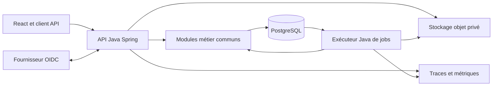

# Architecture et spécifications techniques de Planzone 8

Date : 13 octobre 2026. Statut : direction technique Java validée ; périmètre corrigé sur instruction utilisateur vers une parité fonctionnelle PZ7 1 pour 1. Le catalogue métier est en cours de qualification et ne vaut pas spécification exhaustive validée. Voir le [registre de parité PZ7](../../refoundation/2026-10-13-pz7-parity-baseline.md) et le [plan d’implémentation](../plans/2026-10-13-planzone8-implementation.md).

Planzone 8 sera un produit indépendant, organisé autour d’un backend Java/Spring modulaire et d’une interface React/TypeScript. Il doit permettre à l’équipe actuelle de développer, comprendre et faire évoluer le produit, avec une isolation explicite des clients et des opérations récupérables après incident. La migration de PZ7 fera l’objet d’une étude ultérieure.

## Décisions et périmètre

| Sujet | Décision et origine |
|---|---|
| Backend | Java conservé pour l’équipe actuelle, décision explicite de l’utilisateur |
| Produit | PZ8 indépendant ; migration PZ7 étudiée plus tard, décision utilisateur |
| Hiérarchie | Un client possède une Planzone ; une Planzone contient des zones ; une zone contient des projets, clarification utilisateur |
| Hébergement | Architecture portable ; fournisseur choisi ultérieurement, décision utilisateur |
| Architecture | Monolithe modulaire, PostgreSQL, API et exécuteur de jobs partageant le même métier, choix d’ingénierie |
| Interface | React/TypeScript avec Vite ; structure et parcours remaniés, choix d’ingénierie |
| Référence fonctionnelle | PZ7, reprise 1 pour 1 des fonctions, concepts et parcours ; instruction explicite de l’utilisateur. Le prototype PZ8 est une source secondaire, pas une autorité métier |
| Utilisateurs et ressources | Supprimer le microservice utilisateur métier ; gestion unifiée dans le backend modulaire, en conservant les types de ressources et leurs droits locaux |

La Planzone est la frontière d’isolation du client. Une zone organise ses projets ; elle ne constitue pas un client supplémentaire. L’organisation commerciale, si représentée séparément, est liée à une seule Planzone et ne crée pas un second niveau d’autorisation.

Le périmètre est l’ensemble des fonctions PZ7, y compris celles absentes du prototype PZ8. L’inventaire couvre notamment projets, planning, ressources, capacité/charge/occupation, unités organisationnelles, calendrier, temps, budgets, documents, discussions, rapports, personnalisation, droits et parcours de compte. Une fonction non encore inspectée reste à qualifier ; elle ne devient pas hors périmètre. Les extensions réellement nouvelles sont décidées séparément.

La refonte conserve les résultats métier, concepts, parcours et possibilités de PZ7. Les contrats internes et le stockage peuvent évoluer avec des preuves d’équivalence observables. Toute correction d’un comportement historique affectant un résultat visible est recensée explicitement. L’indépendance du démarrage et le report de la migration de données n’autorisent aucune réduction fonctionnelle. Le développement commence avec des données synthétiques.

## Preuves et limites

Le [registre PZ7](../../refoundation/pz7-evidence.json) conserve les dépôts, commits et chemins inspectés. Le backend PZ7 lu est le commit a8684583e9b47826bc3061d0e089a1eee706933e ; la baseline technique du prototype PZ8 est 570673d. Ces versions de dépôt ne certifient pas l’état des environnements déployés. La [passe de parité](../../refoundation/2026-10-13-pz7-parity-baseline.md) identifie les erreurs du premier cadrage, les preuves correctives et les zones non examinées. Le dépôt UAA est visible, mais sa lecture est refusée par GitLab (403) ; ses contrats sont observés depuis core.

| Affirmation | Statut et source | Confiance et conséquence |
|---|---|---|
| PZ8 lit globalement ses collections et son contrat de stockage est synchrone | Vérifié, [contrat existant](../../../server/contracts.ts), lignes 20 à 25 | Élevée : remplacer uniquement la base laisserait le principal problème structurel |
| Le Worker réécrit un snapshot avec contrôle de révision | Vérifié, [Worker](../../../cloudflare/worker.ts), lignes 215 à 235 | Élevée : conserver la concurrence contrôlée, remplacer l’unité de persistance globale |
| Une mutation est suivie du rechargement de tout l’état | Vérifié, [interface](../../../src/App.tsx), lignes 124 à 131 | Élevée : distinguer succès d’écriture et échec de rafraîchissement |
| Sessions, droits serveur et filtrage financier existent | Vérifié, [authentification](../../../server/auth.ts), [permissions](../../../shared/permissions.ts) | Élevée sur le code lu ; aucune garantie globale de sécurité en production |
| PZ7 emploie Java 21, Spring, MySQL, Liquibase et des traitements différés | Vérifié, registre PZ7 | Élevée sur les dépendances ; la version ancienne de Spring ne fixe pas celle de PZ8 |
| L’équipe doit conserver Java | Confirmé par l’utilisateur le 13 octobre 2026 | Décision contraignante ; remplace l’hypothèse de compétences équivalentes |
| Un client possède une Planzone avec plusieurs zones | Confirmé par l’utilisateur | Cardinalité cible, indépendamment de ce que permet un schéma historique |
| Build, types et 355 tests PZ8 passent | Vérifié lors de la baseline locale précédente | Référence existante uniquement ; ne prouve ni transactions Java, ni RLS, ni capacité cible |

Les volumes réels, la concurrence, les objectifs de disponibilité et de restauration restent à cadrer avant tout engagement de service. Les pratiques précises de l’équipe en JPA, SQL et exploitation PostgreSQL restent une hypothèse à confronter à la première tranche. Les changements non commités du chat cloud ne sont pas intégrés à la référence locale.

## Choix technique et arbitrage

La comparaison initiale attribuait, à compétences équivalentes, 3,85/5 à TypeScript/PostgreSQL et 3,70/5 à Java/PostgreSQL. Pondérations : maintenabilité 25 %, transactions 25 %, exploitation 15 %, continuité PZ8 15 %, portabilité 20 %. Ces notes étaient des jugements, sans benchmark.

La décision de conserver Java rend cette hypothèse caduque : la continuité de l’équipe est une contrainte, pas un petit bonus à ajouter au score. Java/Spring devient la direction retenue. Les mêmes exigences de sécurité et de récupération restent applicables.

| Élément | Cible initiale |
|---|---|
| Java | Java 21, distribution Eclipse Temurin maintenue ; aucune fonctionnalité preview |
| Serveur | Spring Boot 4.1.x, Spring MVC, Spring Security ; versions associées gérées par BOM |
| Modules | Spring Modulith 2.1.x et contrôles ArchUnit des frontières |
| Construction | Gradle Wrapper, scripts Kotlin, versions et vérification des dépendances verrouillées |
| Base | PostgreSQL 18, correctifs maintenus ; une base relationnelle commune avec isolation par Planzone |
| Migrations | Liquibase, changelog versionné unique ; SQL explicite pour contraintes et RLS |
| Persistance initiale | Spring JDBC/JdbcClient, requêtes paramétrées et adaptateurs ciblés |
| API | REST JSON versionné ; contrat OpenAPI et client TypeScript généré |
| Connexion | OIDC via Spring Security ; sessions serveur partagées |
| Interface | React, TypeScript strict, Vite, TanStack Query |
| Documents | Stockage objet privé derrière une interface portable |
| Traitements différés | Outbox et file durable PostgreSQL |
| Exploitation | Images OCI, métriques Micrometer et traces OpenTelemetry compatibles |

Java 21 limite les changements simultanés pour l’équipe ; sa distribution Temurin dispose encore d’un horizon de maintenance publié. Java 25 pourra être adopté dans une mise à jour isolée. Spring Boot 4.1 accepte Java 21 ; la release Modulith 2.1 est alignée sur Boot 4.1. Les correctifs exacts seront verrouillés lors de l’initialisation du build, sans dépendance flottante ni version de prépublication. [Temurin](https://adoptium.net/support/), [prérequis Spring Boot](https://docs.spring.io/spring-boot/system-requirements.html), [release Modulith](https://github.com/spring-projects/spring-modulith/releases/tag/2.1.0), [maintenance PostgreSQL](https://www.postgresql.org/support/versioning/)

JDBC rend explicites les requêtes, les conditions de mise à jour et les projections du premier parcours. Son coût est le mapping à maintenir. JPA pourra être utilisé dans un adaptateur d’agrégat lorsqu’il réduit ce coût : un seul adaptateur possède l’écriture d’un agrégat, aucune association persistante ne traverse les modules, aucune entité n’est exposée par HTTP. Son introduction exigera une preuve que contexte, mutation, reçu et outbox utilisent la même transaction. Ce choix local n’impose pas un second framework de persistance au démarrage. [JDBC Spring](https://docs.spring.io/spring-framework/reference/data-access/jdbc/core.html)

## Organisation du dépôt

```text
apps/
  web/                       application React, routes et fonctions
packages/
  api-client/                client TypeScript généré depuis OpenAPI
  ui/                        composants accessibles et tokens visuels
contracts/
  openapi/                   contrat HTTP versionné et vérifié
backend/
  core/                      bibliothèque de modules métier
  api/                       application Spring Boot HTTP et sessions
  jobs/                      application Spring Boot de traitements différés
  migrations/                changelog Liquibase et SQL
  build-logic/               conventions Gradle communes
deploy/
  local/                     environnement de développement reproductible
  containers/                construction et configuration des images
docs/
  superpowers/specs/
```

Trois sous-projets Gradle suffisent initialement : core, api et jobs. Les modules métier sont des packages logiques dans core, plutôt qu’un projet de build par concept. Le frontend possède sa chaîne npm et son lockfile ; le backend possède son wrapper et ses verrous Gradle. Les commandes de vérification du dépôt orchestrent les deux.

Chaque module expose une petite API de cas d’usage et de types publics. Ses règles métier, orchestration et adaptateurs restent internes. Le domaine utilise des objets Java, sans dépendance HTTP, ORM ou Spring. Les cas d’usage coordonnent les ports nécessaires aux vraies frontières : persistance, identité, horloge, fichiers et effets externes. Il n’y a pas d’interface systématique pour chaque classe.

Les controllers valident les contrats et traduisent les erreurs ; ils invoquent un cas d’usage sans requête SQL directe. API et jobs utilisent les mêmes entrées publiques. Les packages internes, cycles et dépendances non déclarées font échouer la CI, y compris depuis les applications api et jobs. Modulith fournit une partie de ces vérifications ; ArchUnit protège aussi les couches du domaine. [Vérification Modulith](https://docs.spring.io/spring-modulith/reference/verification.html)

| Module | Responsabilités |
|---|---|
| people | Gestion unifiée des utilisateurs et ressources : identité de connexion, profil local, invitation, activité, appartenances et droits ; sous-domaines internes distincts |
| planzones | Client, Planzone, zones, organisation des projets et frontière d’isolation |
| organization | Unités organisationnelles, rattachements et responsabilités ; relations conformes aux règles PZ7 qualifiées |
| capacity | Calendriers, indisponibilités, capacité, charge et occupation ; projections à partir des allocations et temps |
| projects | Projets, membres, paramètres, statuts et rattachement à une zone |
| planning | Listes, tâches, jalons, dépendances, déplacements et modèles |
| time | Saisies, validation, intégration et conservation des tarifs |
| budget | Dépenses, recettes et projections financières autorisées |
| collaboration | Documents, dossiers et discussions |
| reporting | Rapports, définitions enregistrées, exports et intégrations de restitution |
| customization | Définitions de champs, vues et modèles personnalisables |
| platform | Adaptateurs techniques partagés, sans règles métier transversales |

Cette carte de responsabilités guide la qualification ; les frontières précises seront vérifiées avec les parcours PZ7 avant extraction de code. people reste un module interne : aucun service réseau utilisateur métier séparé, ni copie concurrente de profil utilisateur et de profil ressource. Ses sous-domaines authentification, profil, autorisation et planning ne deviennent pas une classe ou une table universelle. L’actuel package identity du socle est un élément à intégrer à cette frontière, pas la préfiguration d’un microservice.

Une lecture de synthèse peut disposer d’une projection SQL transversale explicitement recensée. Elle n’autorise pas les autres modules à modifier les tables de ses voisins. Les opérations touchant plusieurs domaines ont un cas d’usage orchestrateur identifié et une seule transaction pour leurs écritures locales. Les échanges avec un fournisseur d’identité restent des effets externes réconciliables.

## Composants et flux



API et jobs produisent deux exécutables et deux images issus du même commit. L’API ne démarre pas de consommateur de jobs. L’exécuteur n’expose pas les controllers métier publics. Leurs pools, limites de concurrence et ressources peuvent être réglés séparément.

PostgreSQL est l’autorité des données métier. Les requêtes ciblées remplacent le chargement de toute la Planzone. La recherche initiale peut utiliser ses index si elle satisfait les résultats, champs, tris, pertinence et droits PZ7 qualifiés ; la présence de Lucene dans PZ7 interdit de présumer cette équivalence. Un cache distribué, un broker supplémentaire ou un moteur de recherche séparé répondra à un besoin fonctionnel établi ou une limite mesurée.

## Modèle métier et invariants

Les contraintes confirmées ci-dessous remplacent le catalogue initial dérivé du prototype PZ8. Elles ne couvrent pas encore tous les comportements PZ7. Le registre de parité contient les sources exactes, les règles restant à lire et les critères de preuve. Une règle inconnue bloque la généralisation du schéma concerné, sans être remplacée par une simplification du prototype.

| Domaine | Contrainte et état de qualification |
|---|---|
| Hiérarchie | Client → une Planzone → zones → projets. Une ressource appartient à une Planzone, même si son identité de connexion intervient chez plusieurs clients |
| Affectations | Plusieurs allocations possibles pour une tâche ; une allocation relie une tâche et une ressource. Ne pas imposer une ressource unique |
| Contraintes de planning | Plusieurs contraintes, points START/END, types AT_LEAST/AT_MOST/EXACTLY et décalages ; qualifier les règles de propagation et de cycle avant de les implémenter |
| Duplication et modèles | PZ7 copie notamment des membres, groupes et allocations selon le parcours, avec remise à zéro de progression. Ne pas supprimer ces affectations par défaut |
| Ressources | HUMAN, VIRTUAL et MATERIAL ; compte de connexion facultatif. Une ressource humaine invitée peut exister avant le compte |
| Identité | Une identité peut intervenir dans plusieurs Planzones par des profils locaux distincts ; les données, coûts et droits restent locaux |
| Organisation | Rattachement organisationnel unique dans le modèle PZ7 lu ; responsabilités/managers distincts de ce rattachement et des droits |
| Temps | Unicité PZ7 ressource/tâche/date et parcours d’upsert ; qualifier corrections, validation, intégration et limites par scénario |
| Coûts | PZ7 calcule un tarif en fonction de la date et de l’historique des profils. Aucun snapshot de tarif par saisie n’est démontré ; qualifier les modifications rétroactives avant de changer ce résultat |
| Transfert et historique | Les allocations et les temps sont des relations distinctes. Qualifier transfert, désactivation et suppression séparément, notamment leurs effets historiques |
| Restitution | Préserver les périmètres, filtres, tris et résultats des vues calendrier, Gantt, Kanban, capacité, charge, occupation et rapports |

Sources : [catalogue PZ7 et liens au code](../../refoundation/2026-10-13-pz7-parity-baseline.md). Les tests du prototype PZ8 restent utiles pour ses régressions propres ; ils ne suffisent pas à prouver la parité PZ7.

Les unités organisationnelles et les zones restent distinctes. La cardinalité multiple du prototype PZ8 ne remplace pas le rattachement unique du PZ7 inspecté. Fermeture de projet, jalons, déplacements, intégration et règles financières doivent être qualifiés à partir de PZ7 avant portage ; leurs anciennes formulations issues du prototype sont retirées.

## Nombres et dates

Montants, heures, capacités et tarifs sont représentés par BigDecimal dans le métier et NUMERIC dans PostgreSQL. Les valeurs reçues sont des chaînes décimales canoniques dans l’API ; le client TypeScript conserve ce format. Les valeurs calculées officielles viennent du backend. Une conversion en nombre JavaScript pour un graphique n’alimente jamais une écriture ou un calcul financier de référence.

Les entrées sont conservées dans les limites de précision et de magnitude établies par les cas PZ7. Les unités, arrondis, ordre d’agrégation et règles de division seront spécifiés par calcul métier, avec résultats de référence. Le changement de langage ne justifie aucune modification silencieuse de somme ou de durée.

Les valeurs limites du prototype (0.015, 0.1 + 0.2, 0.005) sont des candidats de test technique, pas des règles de parité à imposer à PZ7. L’affichage EUR est observé sur une vue budget PZ7 ; les devises supportées et leur configuration restent à établir. Aucun verrou EUR global ne sera introduit sur cette seule preuve. Le passage aux chaînes décimales est une évolution explicite du contrat technique.

LocalDate représente les dates civiles, LocalTime les heures civiles et Instant les événements horodatés lorsque le cas d’usage le demande. Le planning PZ7 conserve aussi des heures et fuseaux (ZonedDateTime et contraintes horaires) : une conversion générale en LocalDate est interdite. La représentation persistée conserve l’instant et/ou la date/heure locale avec la zone nécessaire au contrat métier. Les règles précises d’« aujourd’hui », changements d’heure et absences partielles sont à qualifier dans PZ7 ; Europe/Paris ne devient pas une constante produit sur la seule base du prototype.

## Identité et droits

La connexion utilise OIDC avec authorization code, PKCE, contrôle de corrélation et validation des tokens. Une identité est liée au couple issuer/subject ; l’email ne vaut pas preuve d’appartenance. Le fournisseur reste interchangeable. Les tokens fournisseur restent côté serveur ; React reçoit un cookie de session opaque, HttpOnly, Secure en HTTPS, avec attributs de portée et SameSite adaptés au flux. [OIDC](https://openid.net/specs/openid-connect-core-1_0.html#ClaimStability), [sécurité OAuth](https://www.rfc-editor.org/rfc/rfc9700.html)

Les sessions sont partagées dans PostgreSQL via Spring Session JDBC pour permettre plusieurs instances API. La configuration de persistance, sérialisation et expiration est explicite ; aucun mot de passe n’est reconstruit dans les modules métier. Le fournisseur, les exigences de MFA et les durées de session seront arrêtés avant ouverture aux clients. [Sessions JDBC](https://docs.spring.io/spring-session/reference/configuration/jdbc.html)

Spring Security conserve la protection CSRF des mutations à session navigateur. Le client transmet le token dans un en-tête et le renouvelle après connexion/déconnexion. Origines autorisées, TLS, cookies et en-têtes de sécurité sont configurés ; masquer un bouton ne vaut jamais contrôle de droit. [CSRF Spring Security](https://docs.spring.io/spring-security/reference/servlet/exploits/csrf.html)

Les permissions PZ7 sont la référence : rôles, privilèges, champs non éditables, appartenances et désactivations doivent être reliés aux opérations exposées. La liste de quatre rôles Planzone et trois rôles projet du prototype ne constitue pas un mapping suffisant. Le rôle et l’activité d’une ressource restent propres au client. Les rôles minimaux actuellement codés dans le socle Java servent ses tests d’isolation ; ils seront alignés avant toute ouverture des fonctions métier.

Les restrictions de zone, groupes, projets et champs doivent être recensées dans PZ7, y compris les requêtes et réglages configurés. Aucune restriction existante n’est exclue faute d’être présente dans le prototype. Aucun rôle nouveau n’est inventé sans besoin établi. Une préférence de vue ou de zone n’accorde aucun droit.

L’unification people conserve les différences entre invitation en attente, profil ressource actif, appartenance projet et capacité de connexion. Une affectation ou un historique ne crée pas implicitement un accès. Les règles de création/retrait d’appartenance induites par les opérations PZ7 seront explicitées et testées avant portage. La révocation locale et la désactivation globale du compte sont deux opérations différentes.

Un contexte vérifié contient identité, Planzone, zone/projet lorsque pertinent, requête et versions d’autorité. Les onglets n’utilisent pas une « Planzone courante » globale comme autorité. Les privilèges de support plateforme sont séparés de l’administration cliente, ciblés et tracés ; aucun identifiant fixe de ressource ne donne un pouvoir transversal.

## Schéma relationnel et isolation

| Tables ou groupes | Contraintes |
|---|---|
| identities, external_identities, sessions | Identité globale, unicité issuer/subject, version de révocation ; accès de bootstrap strictement limité |
| organizations, planzones | Lien commercial un à un ; Planzone comme frontière cliente |
| planzone_memberships, planzone_security_state | Adhésion active, rôle, politique, état et version d’autorité |
| zones, projects, zone_memberships, project_memberships | Chaque zone dans sa Planzone ; chaque projet dans sa zone ; rattachements zone et projet distincts, droits à qualifier |
| resources, organization_units, resource_responsibilities | Profil ressource client unifié, identité optionnelle, rattachement et responsabilités conformes à PZ7 |
| task_lists, tasks, allocations, planning_constraints | Allocations multiples ; contraintes typées entre éléments avec points et décalages. Cardinalités et références qualifiées avant migration SQL |
| time_entries, integration_policies, cost_profiles, cost_history | Dates, validations et historique de coût ; résultats PZ7 à préserver, stockage final non figé |
| expenses, revenues | Montants exacts et dates métier |
| documents, folders, discussions, reports | Métadonnées autorisées, objets privés et historique |
| operation_receipts, audit_events, outbox, jobs | Traçabilité, résultat durable, intentions et tentatives de traitement |

Toute donnée cliente porte planzone_id. Les clés étrangères composées incluent le périmètre : un projet ne peut pointer vers la zone d’un autre client ; une tâche ne peut pointer vers la liste d’un autre projet. Les unicités correspondent aux règles PZ7 qualifiées et aux décisions utilisateur, sans extrapolation depuis le prototype. Les liens d’identité globale sont des exceptions documentées aux relations purement clientes. [Contraintes PostgreSQL](https://www.postgresql.org/docs/current/ddl-constraints.html)

RLS complète les filtres métier sur toutes les tables clientes, avec règles de lecture et d’écriture. Le rôle applicatif n’est ni propriétaire, ni superuser, ni BYPASSRLS ; il ne peut modifier les politiques ou le schéma. Le rôle de migration est distinct. Une politique sans contexte refuse l’accès. Les partitions éventuelles et leurs accès directs sont couverts par les mêmes contraintes.

RLS protège notamment contre l’oubli d’un filtre de Planzone. Elle ne protège pas une application compromise capable de fabriquer un contexte et ne remplace pas les droits d’action, de projet ou de champ. Les erreurs de contraintes sont traduites sans divulguer des identifiants étrangers. [Limites RLS](https://www.postgresql.org/docs/current/ddl-rowsecurity.html)

Le contexte PostgreSQL est installé par set_config paramétré et local à la transaction, sur sa connexion. Aucun SET persistant de session n’est utilisé. Un changement de Planzone pendant la transaction est interdit. JSONB reste limité aux structures variables ; les champs recherchés, références et règles de validité essentielles restent relationnels.

## Transactions et révocation concurrente

Une entrée technique PlanzoneUnitOfWork, fondée sur TransactionTemplate, encadre chaque cas d’usage client. Elle porte la mécanique Spring, tandis que le domaine reste indépendant. Le choix rend l’ordre d’établissement du contexte explicite et évite de dépendre d’une auto-invocation annotée. [Transactions Spring](https://docs.spring.io/spring-framework/reference/data-access/transaction/programmatic.html)

Une commande suit cet ordre :

1. Authentifier la session ; considérer les identifiants de l’URL comme des candidats.
2. Ouvrir la transaction sur la connexion gérée par Spring.
3. Effectuer le bootstrap ciblé d’identité et d’appartenance par une interface d’autorité limitée. Son rôle ne donne aucun accès général aux tables métier. Si des fonctions SQL privilégiées sont nécessaires, leurs paramètres, privilèges et search_path sont fixes et testés.
4. Acquérir les verrous d’autorité, puis relire compte, session, adhésion et état de Planzone ; installer le contexte local vérifié avant tout accès métier.
5. Vérifier action, champs, références, clé de commande et version attendue ; appliquer les invariants.
6. Écrire mutation, nouvelle version, historique obligatoire, reçu d’opération et outbox dans la même transaction.
7. Construire la réponse autorisée ; envoyer le succès HTTP seulement après confirmation du commit.

Les opérations ordinaires prennent un verrou FOR SHARE sur l’état d’autorité de la Planzone. Les modifications d’appartenance, de rôles, de politiques ou de suspension prennent le verrou exclusif correspondant avant modification. La révocation globale de session/identité suit le même principe sur l’état d’identité. Une commande passe ainsi avant une révocation, ou constate son effet après son commit ; elle ne valide pas des droits puis écrit librement après leur révocation.

L’ordre de prise des verrous est constant : autorité d’identité, autorité de Planzone, clé d’opération, puis agrégats dans un ordre stable. Une opération qui modifie les droits prend directement le mode exclusif nécessaire, sans conversion tardive d’un verrou partagé. FOR KEY SHARE ne remplace pas FOR SHARE pour ce protocole. La première tranche doit reproduire les courses et les deadlocks utiles. [Verrous PostgreSQL](https://www.postgresql.org/docs/current/explicit-locking.html)

Les données métier utilisent READ COMMITTED avec versions attendues et verrous d’agrégat lorsqu’un invariant porte sur plusieurs lignes. Par exemple, l’édition du graphe d’un projet prend une coordination commune avant contrôle des cycles. Une erreur de concurrence produit un conflit explicite ; zéro ligne modifiée n’est jamais un succès.

Tout échec métier ou technique annule l’unité de travail. La conversion en erreur HTTP a lieu après rollback ; une exception absorbée ou un objet « échec » retourné ne doit pas déclencher un commit partiel. Les appels réseau sont exclus de cette transaction. Un nouveau thread ou une nouvelle transaction doit acquérir son propre contexte et ses droits ; @Async ne prolonge pas la transaction courante.

Si JPA est introduit, open-in-view est désactivé, les DTO sont matérialisés avant la sortie et les accès JDBC/JPA utilisent la même connexion transactionnelle. Les caches ORM clients restent désactivés tant que leur partitionnement et leur invalidation ne sont pas démontrés. [Sémantique des annotations](https://docs.spring.io/spring-framework/reference/data-access/transaction/declarative/annotations.html), [synchronisation des ressources](https://docs.spring.io/spring-framework/reference/data-access/transaction/tx-resource-synchronization.html)

## Contrats API et opérations incertaines

OpenAPI est le contrat publié des DTO de commande, de réponse et des erreurs. Les DTO Java valident à l’exécution valeurs, champs inconnus, omission et null ; leur conformité au contrat est vérifiée par des scénarios HTTP. Le client TypeScript est généré de manière reproductible et n’importe jamais les entités de persistance.

Les routes de collection utilisent notamment /api/v1/planzones/{planzoneId}/zones/{zoneId}/projects. Les routes d’objet peuvent utiliser /api/v1/planzones/{planzoneId}/projects/{projectId}, afin de conserver une référence stable après changement de zone. Le serveur résout et vérifie la zone réelle. Les filtres, tris et tailles de page sont bornés ; les curseurs incluent le tri et un identifiant de départage, sans valoir autorisation.

| Cas | Réponse publique |
|---|---|
| Session absente ou expirée | 401 et code stable |
| Action interdite sur un objet déjà accessible | 403 |
| Identifiant absent ou hors périmètre visible | 404, sans révéler l’existence étrangère |
| Version périmée ou même clé avec autre contenu | 409 avec code précis |
| Entrée invalide | 400 avec erreurs de champs autorisées |
| Commande différée acceptée | 202 avec operationId et état consultable |
| Limite de débit ou concurrence atteinte | 429 avec indication de reprise |

Les erreurs contiennent code, message utilisable et requestId. Les traces SQL et exceptions internes restent privées. Les réponses de mutation, recherche, export et résultat de job appliquent le même filtrage de confidentialité que les lectures ordinaires.

Les créations et opérations produisant des effets exigent Idempotency-Key. L’unicité est définie par Planzone, acteur, opération et clé ; l’empreinte inclut l’entrée canonique et les identifiants concernés. Une clé rejouée avec une autre entrée est refusée. La réponse perdue après commit est retrouvée par cette clé, après recontrôle des droits. Un reçu ne constitue pas une copie de données financières librement rejouable.

Les reçus sont conservés pendant la phase initiale, avec une politique de rétention à définir avant ouverture commerciale. Une future expiration sera publiée dans le contrat ; une opération au résultat incertain ne sera jamais recréée automatiquement avec une nouvelle clé. La purge et la prévention de réutilisation des clés seront traitées ensemble.

L’édition utilise une version attendue. Une reprise après deadlock ou incident transitoire est bornée, reprend toute la transaction et conserve la clé d’opération. Un commit dont le résultat est inconnu déclenche une consultation du reçu avant toute nouvelle tentative.

## Interface et expérience utilisateur

L’interface est organisée par fonctions métier, avec routes et composition séparées des composants partagés. Elle affiche clairement la Planzone, la zone et le projet actifs. Les données du contexte précédent sont retirées au changement de périmètre et à la déconnexion.

TanStack Query gère les lectures serveur. Ses clés incluent identité, Planzone, projet ou zone, visibilité et paramètres. Les résultats des anciennes requêtes ne doivent pas repeupler une vue après changement de contexte. Les commandes mettent à jour ou invalident les seules projections concernées. [Clés de requêtes](https://tanstack.com/query/latest/docs/framework/react/guides/query-keys)

Trois états sont visibles et distincts : action refusée ; action enregistrée avec rafraîchissement indisponible ; résultat d’enregistrement inconnu. Dans le dernier cas, l’interface recherche le reçu et conserve la saisie. Une erreur de lecture après succès d’écriture n’invite pas à recréer l’objet.

Le système de composants harmonise navigation, formulaires, tableaux, dialogues, états vides et erreurs. Les parcours critiques sont utilisables au clavier ; le focus et les erreurs de formulaire sont explicites. Gantt et grandes listes utilisent fenêtres et virtualisation selon les mesures. Cette architecture ne fixe pas encore une charte graphique ou une maquette finale.

## Jobs et effets externes

L’outbox enregistre l’intention d’un effet dans la transaction métier. La file durable conserve identifiant d’opération, Planzone, demandeur ou capacité système limitée, payload versionné, tentative, date de reprise, bail et dernière erreur. Les reprises ont un plafond configurable ; un échec définitif reste inspectable. [Principe de l’outbox](https://docs.aws.amazon.com/prescriptive-guidance/latest/cloud-design-patterns/transactional-outbox.html)

Le dispatcher accède uniquement aux métadonnées nécessaires pour réclamer des jobs. Cet accès transversal ne donne pas accès aux données métier. Le worker ouvre ensuite une nouvelle transaction au périmètre de la Planzone, avec droits revalidés. Une tentative dispose d’un numéro de génération : un worker ancien ne peut publier le résultat d’une tentative reprise.

La génération longue et les appels externes se déroulent sans conserver les verrous d’autorité. Les exports sont produits dans un emplacement privé, puis leur publication et leur remise recontrôlent les droits. Une révocation empêche une remise future ; elle ne retire pas une copie déjà téléchargée.

Une clé d’effet stable est transmise au destinataire lorsqu’il sait dédupliquer. S’il ne le sait pas et que la réponse est perdue, l’effet passe en état inconnu pour réconciliation. L’outbox ne promet pas une livraison externe exactement une fois. API et jobs bornent leur concurrence par client afin qu’un export volumineux ne monopolise pas les autres usages.

## Documents et confidentialité

Les métadonnées documentaires sont relationnelles ; le contenu est stocké en privé. Le nom physique est généré et indépendant du nom utilisateur. Le flux passe par réservation, dépôt temporaire, contrôle de taille/type/contenu, analyse, puis publication. Un fichier refusé ou un dépôt abandonné est nettoyé par un job traçable.

Aucun objet ne devient accessible par simple connaissance de son identifiant. Le téléchargement authentifié recontrôle les droits ; une URL signée éventuelle possède une durée courte définie par le contrat. Les liens externes sont validés comme liens ; aucun téléchargement serveur arbitraire n’est ajouté implicitement.

Les secrets viennent de l’environnement d’exploitation. Tokens, mots de passe, URL signées et contenus sensibles sont exclus des logs. L’audit obligatoire conserve acteur, périmètre, action, cible, résultat et horodatage, avec données minimisées. Sa politique de conservation et la suppression des données clientes sont définies avant mise en service, sans promesse réglementaire déduite de la seule architecture.

## Déploiement et exploitation

API et jobs tournent dans des conteneurs sans données persistantes locales. Le frontend est servi sous la même origine que l’API, directement ou via un reverse proxy. La configuration est validée au démarrage ; les sondes distinguent vie du processus et aptitude à traiter les requêtes. L’arrêt gracieux cesse de réclamer des jobs et laisse les baux récupérables.

La chaîne de livraison construit les deux images depuis une version commune, contrôle dépendances et secrets, puis exécute une migration séparée des répliques applicatives. Les migrations utilisent la méthode ajouter, remplir, basculer, retirer. Une fenêtre de compatibilité N/N−1 est testée pour API, jobs et messages. Les changements destructifs sont différés jusqu’à la fin de cette fenêtre.

Les métriques couvrent latence, erreurs, taille des réponses, saturation CPU/mémoire, connexions, requêtes lentes, conflits, attentes de verrous, backlog et âge des jobs. requestId, operationId et jobId relient traces et événements. Les identifiants clients sont utilisables dans les journaux d’accès restreint, sans devenir des dimensions illimitées de métriques.

Les limites portent sur les tailles de page, fenêtres de planning, fichiers, requêtes et traitements simultanés. La campagne de charge inclut plusieurs tailles de clients, un client très actif parmi de petits clients et des exports pendant les écritures. Elle produit une capacité mesurée sur une infrastructure décrite. Les objectifs de latence, disponibilité, RPO et RTO restent à valider avec le coût associé.

## Sauvegarde et restauration

Les sauvegardes couvrent PostgreSQL, les objets et un manifeste de correspondance vérifiable. Des essais réguliers mesurent la restauration réelle. Le PITR PostgreSQL restaure un cluster ; il ne restaure pas directement un seul client. [Récupération PostgreSQL](https://www.postgresql.org/docs/current/continuous-archiving.html)

Pour restaurer une Planzone : restaurer dans un environnement isolé, extraire son périmètre, suspendre ses écritures, vérifier références et objets, puis réimporter selon une procédure contrôlée. Les autres clients restent inchangés. Le mécanisme d’import privilégié n’est pas disponible au rôle applicatif ordinaire.

Le catalogue d’identité, les révocations et les sessions ne sont pas écrasés par la restauration métier d’un client. Jobs, reçus et effets déjà remis sont réconciliés avec l’état courant avant reprise ; aucun ancien accès ou ancien email n’est réactivé automatiquement. Le retour du code, la restauration de données et la compensation d’un effet externe sont des opérations distinctes.

## Transition vers le nouveau socle

Le backend Java démarre dans une base propre avec jeux de données synthétiques. PZ7 sert de référence fonctionnelle pendant le portage. La comparaison porte sur résultats normalisés, refus, historiques, autorisations et absence d’écriture partielle. Un résultat attendu provient d’une règle PZ7 examinée et d’un scénario approuvé, ou d’une exécution PZ7 sur environnement autorisé ; il n’est pas fabriqué en recopiant l’algorithme PZ8.

Une première tranche relie identité, client, Planzone, deux zones, un projet par zone, membre, tâche, saisie de temps, synthèse et export. Une deuxième Planzone sert de témoin d’isolation. Le frontend bascule sur ces endpoints pour un environnement de développement dédié ; un même ensemble de données n’a jamais simultanément deux backends maîtres en écriture.

Les changements techniques sont recensés : service utilisateur intégré, session OIDC, frontières clientes explicites, API paginée, décimaux sous forme de chaînes et traitement des résultats incertains. Pour chacun, les fonctions PZ7 affectées ont leurs critères de compatibilité. Les écarts de résultat métier exigent une décision distincte ; ils ne sont pas absorbés sous l’étiquette « optimisation ».

Une migration ultérieure de données PZ7 aura ses propres essais, mapping d’identifiants et mécanismes de retour. L’inventaire des fonctions, droits et cardinalités PZ7 est nécessaire dès maintenant pour la parité ; il ne peut pas être repoussé à cette migration.

## Vérification et critères de réception

La CI vérifie compilation Java, TypeScript strict, formatage, frontières, cycles, contrats, dépendances verrouillées et tests protégeant des comportements réels. JUnit et des intégrations sur PostgreSQL réel, par exemple avec Testcontainers, couvrent les transactions et RLS avec le rôle de production. Les scénarios navigateur couvrent les parcours critiques ; aucune quantité de tests ou couverture exhaustive n’est un objectif.

| Preuve | Résultat exigé |
|---|---|
| Identifiants d’une autre Planzone dans lecture, écriture, recherche, export et fichier | Refus sans divulgation et sans mutation partielle |
| Connexion réutilisée après succès, erreur et rollback ; contexte absent | Aucun héritage du périmètre précédent, aucun accès sans contexte |
| Révocation concurrente avec commande | Ordre conforme au protocole de verrouillage, aucune écriture tardive autorisée par un ancien droit |
| Version d’objet périmée | Conflit explicite, aucune perte silencieuse |
| Deux modifications concurrentes de contraintes | Aucune mise à jour perdue ni violation des règles PZ7 qualifiées de propagation et de cohérence |
| Échec après une première écriture | Mutation, historique, reçu et outbox annulés ensemble |
| Réponse perdue après commit puis répétition | Un seul résultat métier, retrouvé avec droits actuels |
| Clé réutilisée avec un autre corps | Refus sans second effet |
| Worker interrompu puis double exécution | Reprise observable ; ancienne tentative incapable de publier le nouveau résultat |
| Export préparé puis droits retirés | Remise refusée, fichier restant privé |
| Modification de tarif, réaffectation, désactivation et correction de temps | Résultats équivalents aux scénarios PZ7 qualifiés, y compris rétroactivité et auteurs historiques |
| Seuils d’intégration projet et ressource | Comparaison jour précédent/jour même/jour suivant et valeur absente pour chaque opération ; ne pas confondre saisie et export BI |
| Décimaux et calendrier lors du changement d’heure | Sommes, unités, arrondis et dates équivalents aux cas PZ7 ; aucune constante du prototype imposée sans preuve |
| Deux allocations sur une tâche et plusieurs contraintes | Conservation de toutes les relations et résultats de progression/planning attendus |
| Ressource sans compte, invitation, compte dans deux Planzones | Fonctions conservées, profil et droits locaux isolés ; aucun accès accordé par simple rapprochement d’email |
| Clone et déplacement interrompus | Structure atomique et références cohérentes |
| Deux onglets, deux zones, changement de Planzone | Aucune fuite de cache ni changement d’autorité implicite |
| Restauration d’un client | Cohérence de ses données/objets, autres clients préservés, accès et effets non réactivés |
| Déploiement N/N−1 | Compatibilité de schéma et de messages pendant la fenêtre annoncée |

La démonstration de la première tranche doit montrer les mêmes sommes dans feuille de temps, synthèse et export ; une écriture réussie malgré un rafraîchissement indisponible ; une tentative d’accès à l’autre client refusée ; une reprise de job après arrêt. Les contrôles comprennent les données persistées, pas seulement les réponses HTTP.

Les 355 tests de baseline concernent le prototype PZ8. Le premier socle Java a ensuite été vérifié localement : voir les [preuves du lot 1](../../refoundation/2026-10-13-foundation-validation.md). Ces contrôles portent sur build, frontières, API fermée et isolation PostgreSQL ; ils ne démontrent pas la parité PZ7. Aucun benchmark comparatif PZ7/PZ8 ni exécution complète PZ7 n’a été réalisé durant cette revue.

## Synthèse des lectures et contradiction

Les trois lectures indépendantes ont porté sur métier, sécurité et exploitation. La synthèse et la contradiction ci-dessous sont celles de l’agent principal.

| Point | Accord ou désaccord et arbitrage |
|---|---|
| Java | Décision utilisateur ; l’expérience de l’équipe remplace l’hypothèse de compétences équivalentes |
| Version du JDK | Java 25 apporte un horizon plus long ; Java 21 est retenu initialement pour limiter les changements simultanés avec une distribution maintenue |
| Persistance | SQL visible utile aux verrous et projections ; JDBC partout pourrait accroître le coût pour une équipe JPA. Premier parcours en JDBC, évolution locale autorisée sous contrat transactionnel |
| Droits de zone | Ne pas inventer de rôles ; qualifier et préserver les restrictions réellement présentes dans PZ7 |
| Portage métier | Un CRUD Java ne démontre pas la parité. Ajout de preuves sur décimaux, dates, capacité, dépendances et intégration |
| Sécurité | Ni Spring, ni RLS, ni une annotation transactionnelle ne démontrent les garanties. Exiger les scénarios de concurrence et de pool réels |

| Échec recherché | Réponse du design |
|---|---|
| Un accès ORM ou un job échappe au contexte | Frontière transactionnelle unique, bootstrap limité, DTO matérialisés et tests PostgreSQL |
| Une révocation intervient entre contrôle et commit | Protocole partagé de verrous d’autorité |
| Deux commandes rendent ensemble le planning incohérent | Coordination de l’agrégat avant validation des règles qualifiées |
| Une reprise restitue d’anciennes données financières | Recontrôle et projection actuelle du reçu |
| Une dépendance en mémoire tient lieu de file durable | Intention enregistrée en outbox, bail et tentatives persistés |
| Une restauration relance des effets ou accès anciens | Réconciliation et séparation identité/données métier |
| Le portage modifie les arrondis ou cardinalités | Catalogue d’invariants et scénarios métier ciblés |
| La structure devient une infrastructure disproportionnée | Trois projets Gradle, petites API publiques, tranche démontrable avant généralisation |

La confiance est élevée sur la direction Java, la hiérarchie confirmée et les écarts de cardinalité identifiés dans les sources. La couverture fonctionnelle reste partielle, avec une limite d’accès au code UAA et aux composants privés. La capacité, les gains de performance et les engagements de service restent à mesurer. La contradiction du nouveau cadrage figure dans le registre de parité ; cette mise à jour ne transforme pas les hypothèses restantes en faits validés.

La revue de cette spécification précède le plan d’implémentation détaillé. Les choix ultérieurs d’hébergeur, d’identité et de niveau de service ne bloquent pas un prototype local ; ils conditionnent l’ouverture aux clients.
